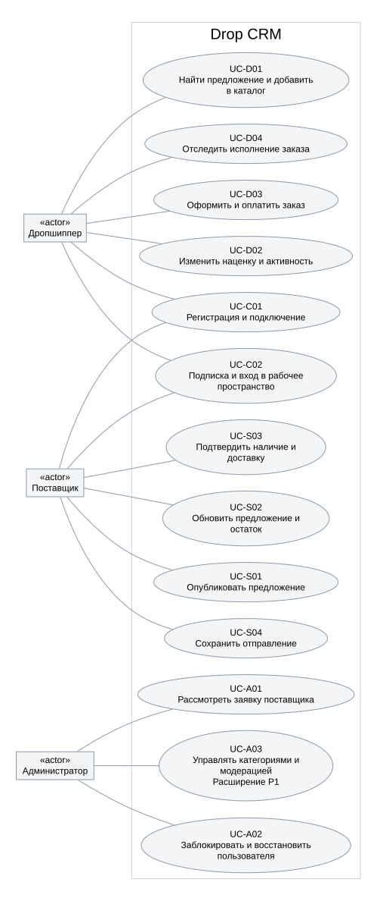

# UML-диаграммы

[Обзор вариантов использования](overview.svg) · [исходник](overview.dot).

## Диаграммы активности

Диаграммы используют начальный/конечный узлы, действия, решения и ветвления. Для каждого сценария показан основной поток и ключевые альтернативы. Полный набор предусловий, ошибок и результатов находится в [сценариях](../scenarios.md). Отдельные схемы не заявляют реализованный серверный процесс.

- [UC-C01. Регистрация и подключение](uc-c01.svg) · [DOT](uc-c01.dot).
- [UC-C02. Подписка и вход в рабочее пространство](uc-c02.svg) · [DOT](uc-c02.dot).
- [UC-D01. Найти предложение и добавить в каталог](uc-d01.svg) · [DOT](uc-d01.dot).
- [UC-D02. Изменить наценку и активность](uc-d02.svg) · [DOT](uc-d02.dot).
- [UC-D03. Оформить и оплатить заказ](uc-d03.svg) · [DOT](uc-d03.dot).
- [UC-D04. Отследить исполнение заказа](uc-d04.svg) · [DOT](uc-d04.dot).
- [UC-S01. Опубликовать предложение](uc-s01.svg) · [DOT](uc-s01.dot).
- [UC-S02. Обновить предложение и остаток](uc-s02.svg) · [DOT](uc-s02.dot).
- [UC-S03. Подтвердить наличие и доставку](uc-s03.svg) · [DOT](uc-s03.dot).
- [UC-S04. Сохранить отправление](uc-s04.svg) · [DOT](uc-s04.dot).
- [UC-A01. Рассмотреть заявку поставщика](uc-a01.svg) · [DOT](uc-a01.dot).
- [UC-A02. Заблокировать и восстановить пользователя](uc-a02.svg) · [DOT](uc-a02.dot).
- [UC-A03. Управлять категориями и модерацией](uc-a03.svg) · [DOT](uc-a03.dot).

Редактируемые описания: scenarios.json. SVG отрендерены Graphviz через @viz-js/viz 3.25.0. Для повторного экспорта DOT можно открыть в совместимом редакторе Graphviz. UC-A03 — расширение P1.
